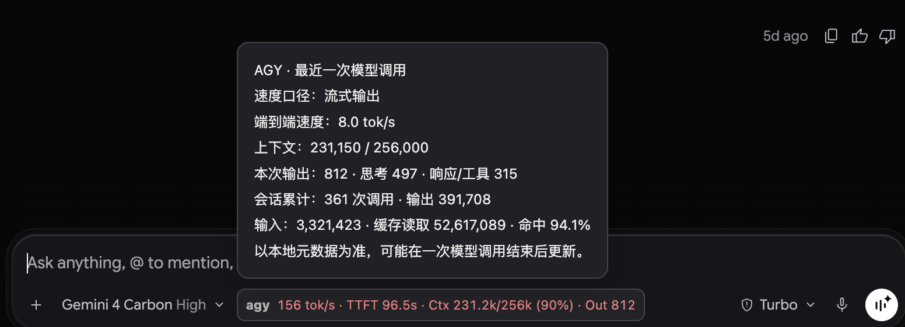

# AGY Token Tips

[简体中文](README.md) · [Download](https://github.com/arShen6/agy-metrics/releases/latest) · [Issues](https://github.com/arShen6/agy-metrics/issues)

Token speed, first-token wait, context usage and output counts **inside the Antigravity Desktop composer**. Hover for the latest call and session totals. The compact bar stays in English; detailed explanations are available in Chinese and English.



*User-provided screenshot of an earlier version. Current tooltips explicitly repeat the status-bar speed and separately label end-to-end speed. The numbers are examples.*

## Download and install

Standalone packages support **macOS Apple Silicon (M series)** and include Node.js. No separate Node, npm or Python installation is needed. Reference client version: **Antigravity 2.32.1**.

1. Open [Releases](https://github.com/arShen6/agy-metrics/releases/latest) and download `agy-token-tips-0.2.2-macos-arm64-en.zip` or `…-zh-CN.zip`. GitHub's automatically generated Source code archives do not contain the runtime.
2. Extract the entire ZIP and double-click **`install.command`**. macOS may ask you to confirm opening it; this project is not Apple-signed or notarized.
3. After service registration succeeds, close Terminal and open an existing Antigravity conversation. A new conversation needs its first completed model call before metrics are available.

The helper runs in the background and starts at login. Installation does not quit active tasks or modify the application bundle. No verified standalone installer is provided for Intel Mac, Windows or Linux in this release.

To change tooltip language, run **`install-en.command`** or **`install-zh.command`**. Both update the same service.

## Metrics

| Field | Meaning |
| --- | --- |
| tok/s | Latest call's output tokens divided by streaming duration, excluding the initial wait |
| TTFT | Wait duration reported by local metadata |
| Hold | Potentially buffered delivery: shows wait time and uses end-to-end speed, including waiting |
| Ctx | Latest uncached input + cached input, divided by the reported context limit |
| Out | Output tokens in the latest call |
| Tooltip | The same bar speed, separate end-to-end speed, timing breakdown, reasoning/response/tool output, session totals and cache hit rate |

For example, 1,971 output tokens, a 9.9-second wait and 20.0 seconds of streaming produce **98.6 tok/s** streaming throughput and **65.9 tok/s** end-to-end throughput. Both are clearly labeled.

Context usage turns yellow at 75% and red at 90%. Missing values display `—`; token counts are never guessed from text length. Local metadata may update only after a model call completes. These metrics are not billing or account quota data.

## How it works

A local UI patch, **not a VSIX extension**. The helper reads local `gen_metadata` usage records and mounts a small widget through a loopback debugging connection. No npm runtime dependencies, API key, chat upload or metrics upload.

The macOS installer uses `~/Library/Application Support/AGY Metrics` and a per-user LaunchAgent. It installs an independent copy, so the extracted download can be moved afterward. The older path and service label are retained for upgrade compatibility.

Antigravity 2.32.1 exposes a dynamic local debugging port. Future client releases may change the private metadata format or UI hooks. This release ships **AGY only**.

## Status, updates and removal

- Double-click **`status.command`** to check the service and widget. `ready: true` means the actual window component was detected.
- To update, run the new installer. It waits for the previous service to fully stop before registering the replacement.
- Double-click **`uninstall.command`** to stop the helper and remove login startup. Version backups and logs remain; Antigravity conversations are untouched.
- Logs: `~/Library/Application Support/AGY Metrics/logs/`.

If nothing appears, finish a model call, check the client version, then run the status tool. Database-busy errors are retried automatically. For compatibility reports, share the app/OS versions and redacted errors, never conversation databases.

## Development

Source checkouts require Node.js >=22.16. The macOS launcher discovers existing installations, including Volta/NVM, without changing the global version.

```bash
bash start.sh install
bash start.sh start --language en
bash start.sh doctor
npm test
npm run demo
```

The demo uses simulated data. Windows/Linux can run the Node entry point with a manually enabled loopback debugging port; those platforms have path tests but no live UI verification. See [protocol notes](docs/protocol.md).

Contributions are welcome: [CONTRIBUTING.md](CONTRIBUTING.md). Other-client proposals need verified telemetry and live UI evidence before being called supported.

Inspired by [chuanban-antigravity-theme-patch](https://github.com/Anarcadia/chuanban-antigravity-theme-patch). Original implementation; no code, themes, fonts or translation resources from that repository are bundled. [MIT License](LICENSE). Unofficial; not affiliated with Google. Bundled Node.js retains its own license in `runtime/LICENSE`.
