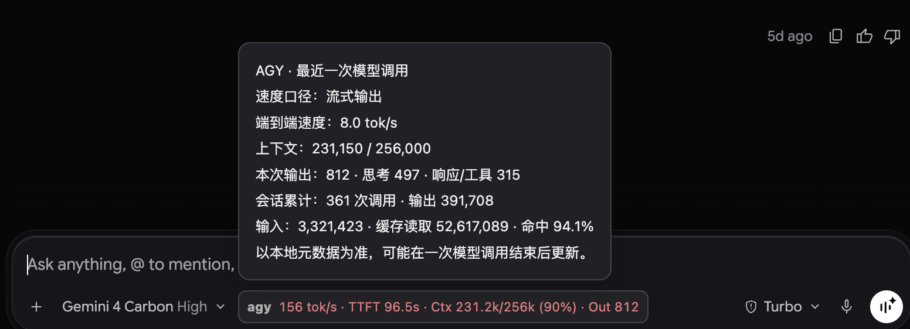

# tokens-tips

**See token usage, context fill, generation speed and first-token wait — right inside Antigravity Desktop.**

**在 Antigravity 输入框旁，查看 token 用量、上下文占用、生成速度和首字等待时间。**

[**Download · English**](https://github.com/arShen6/agy-metrics/releases/download/v0.2.3/tokens-tips-0.2.3-macos-arm64-en.zip) · [**下载 · 中文版**](https://github.com/arShen6/agy-metrics/releases/download/v0.2.3/tokens-tips-0.2.3-macos-arm64-zh-CN.zip)

**Download → unzip → double-click `install.command`.** No commands to type, no separate runtime to install. Runs in the background after installation.

**下载 → 解压 → 双击安装。** 无需手输命令、无需另装运行环境，安装后后台自动运行。

For **macOS Apple Silicon (M series)** · Antigravity **2.32.1** reference version · English / 中文 tooltips



*Preview from an earlier build. Current details explicitly distinguish streaming and end-to-end speed. / 早期版本实机示例；当前详情已明确区分流式速度与端到端速度。*

## What you see

A compact bar beside your composer. Hover for the details — no separate dashboard to open.

输入框旁直接看关键指标，鼠标悬停展开详情，无需打开其他面板。

| Metric | What it shows | 中文说明 |
| --- | --- | --- |
| **Ctx** | Context tokens used / limit, plus percentage | 上下文已用 / 上限与占比 |
| **tok/s** | Output speed of the latest model call | 最近一次模型调用的输出速度 |
| **TTFT / Hold** | First-token wait / wait for buffered output | 首字等待 / 缓冲返回等待时间 |
| **Out** | Output tokens in the latest call | 本次输出 token 数 |
| **Hover details** | Reasoning and response/tool output, session totals | 思考与响应/工具输出、会话累计用量 |
| **Cache** | Cached input and cache hit rate | 缓存读取量与命中率 |

Context usage turns **yellow at 75%** and **red at 90%**. The strip stays in English; choose Chinese or English for the explanations. Data may update after a model call completes.

上下文占用达到 **75% 变黄、90% 变红**。底部统一英文缩写，详细解释可选中英文；数据可能在单次调用完成后更新。

## Install in 3 steps

1. **Download your language above.** Use the installer ZIP, not GitHub's automatic “Source code” archive. / 下载上方对应语言的安装包。
2. **Extract the whole ZIP, then double-click `install.command`.** / 完整解压，双击安装文件。
3. **Open an Antigravity conversation.** Once the service is registered, close Terminal. New conversations show data after their first model call. / 服务注册成功后可关闭终端，新对话完成首次调用后开始显示。

The runtime is included. Starts at login and reconnects when Antigravity reopens. Installation leaves active tasks running.

已内置运行环境，登录后自动启动，Antigravity 重开后自动连接；安装不会关闭正在运行的任务。

| Action | Double-click | 中文 |
| --- | --- | --- |
| Chinese details | `install-zh.command` | 切换中文解释 |
| English details | `install-en.command` | 切换英文解释 |
| Check status | `status.command` | 检查运行状态 |
| Uninstall | `uninstall.command` | 卸载后台服务 |

macOS may ask you to confirm opening the installer; it is not Apple-signed or notarized. Standalone downloads currently target M-series Macs. / 首次打开可能需要系统确认；当前安装包适用于 M 系列 Mac，尚未进行 Apple 签名或公证。

## Understand the numbers

**Streaming speed** excludes the initial wait. **End-to-end speed** includes it. Both are labeled separately in the tooltip, and the tooltip repeats the same speed shown in the bar. Potentially buffered output uses end-to-end speed and the `Hold` label.

**流式速度不含等待，端到端速度包含等待。** 详情分别标注，并重复展示底部相同口径的速度；可能被缓冲的返回使用端到端速度和 `Hold` 标记。

Counts come from local usage metadata. Unknown values stay `—`; tokens are not guessed from text length. These are conversation metrics, not billing or remaining account quota.

数字来自本地用量数据，未知项显示 `—`，不按文本长度猜测 token；这些是会话指标，不代表账单或账户剩余额度。

<details>
<summary>Technical details, troubleshooting and development / 技术说明与排查</summary>

This is an unofficial local UI patch, not a VSIX extension. It reads local `gen_metadata` records and uses a loopback debugging connection to mount the strip. No API key or chat/metrics uploads. No application bundle modification.

The installer keeps the existing `~/Library/Application Support/AGY Metrics` location and LaunchAgent identity for upgrade compatibility. It installs an independent copy, so the downloaded folder can be moved afterward. Uninstall removes login startup and the service; logs and backups remain, and Antigravity conversations are untouched.

If metrics are missing, finish a model call and run `status.command`. `ready: true` means the widget was detected in an actual window. Logs are in `~/Library/Application Support/AGY Metrics/logs/`. Client updates may require adjustments to the private data format or UI hooks. Report your app/OS versions and redacted errors; do not upload conversation databases.

本地只读用量数据，不上传聊天或指标。无显示时先完成一次调用，再运行状态检查；反馈时只附版本和脱敏错误，请勿上传会话数据库。

Source development requires Node.js >=22.16:

```bash
bash start.sh start --language en
bash start.sh doctor
npm test
npm run demo
```

The demo uses simulated data. Windows/Linux have source-level path tests but no verified standalone installer or live UI support. More details: [protocol.md](docs/protocol.md).

</details>

## Contribute

Issues and pull requests are welcome — compatibility fixes, translations and installation improvements. See [CONTRIBUTING.md](CONTRIBUTING.md). Proposals for other clients need verified data sources and live-client evidence.

欢迎提 Issue / PR，共同改进兼容性、翻译和安装体验；其他客户端的适配需提供真实数据来源与实机验证。

Inspired by [chuanban-antigravity-theme-patch](https://github.com/Anarcadia/chuanban-antigravity-theme-patch). Independently implemented; no code or theme assets from that project are bundled. [MIT License](LICENSE). Unofficial, not affiliated with Google. Node.js retains its own license in `runtime/LICENSE`.
