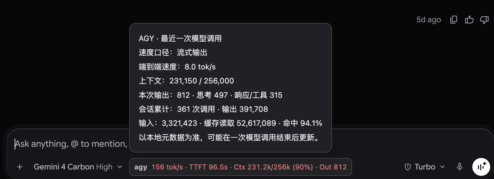

# agy-token-tips

[English](README.md) | [简体中文](README.zh-CN.md)

**在 Antigravity 输入框旁，直接查看 token 用量、上下文占用、生成速度和首字等待时间。**

[**下载 macOS 中文版**](https://github.com/arShen6/agy-token-tips/releases/download/v0.2.4/agy-token-tips-0.2.4-macos-arm64-zh-CN.zip) · [**下载英文版**](https://github.com/arShen6/agy-token-tips/releases/download/v0.2.4/agy-token-tips-0.2.4-macos-arm64-en.zip)

**下载 → 解压 → 双击 `install.command` 安装。** 无需手输命令、无需另装运行环境，安装后后台自动运行。

适用于 **macOS Apple Silicon（M 系列）** · 参考客户端版本：**Antigravity 2.32.1**



*早期版本实机示例；当前详情已明确区分流式速度与端到端速度。*

## 可以看到什么

输入框旁直接看关键指标，鼠标悬停展开详情，无需打开其他面板。

| 指标 | 展示内容 |
| --- | --- |
| **Ctx** | 上下文已用 token / 上限与占比 |
| **tok/s** | 最近一次模型调用的输出速度 |
| **TTFT / Hold** | 首字等待 / 缓冲返回等待时间 |
| **Out** | 本次输出 token 数 |
| **悬停详情** | 思考与响应/工具输出、会话累计用量 |
| **缓存** | 缓存读取量与命中率 |

上下文占用达到 **75% 变黄、90% 变红**。底部统一英文缩写，详细解释可选中英文；数据可能在单次调用完成后更新。

## 三步安装

1. **下载上方对应语言的安装包。** 不要选择 GitHub 自动生成的 `Source code` 源码包。
2. **完整解压，双击 `install.command`。**
3. **打开 Antigravity 对话。** 服务注册成功后可关闭终端；新对话完成首次调用后开始显示。

已内置运行环境，登录后自动启动，Antigravity 重开后自动连接；安装不会关闭正在运行的任务。

| 操作 | 双击文件 |
| --- | --- |
| 切换中文解释 | `install-zh.command` |
| 切换英文解释 | `install-en.command` |
| 检查运行状态 | `status.command` |
| 卸载后台服务 | `uninstall.command` |

首次打开可能需要 macOS 系统确认；当前安装包适用于 M 系列 Mac，尚未进行 Apple 签名或公证。

## 理解这些数字

**流式速度不含等待，端到端速度包含等待。** 详情分别标注，并重复展示底部相同口径的速度；可能被缓冲的返回使用端到端速度和 `Hold` 标记。

数字来自本地用量数据，未知项显示 `—`，不按文本长度猜测 token；这些是会话指标，不代表账单或账户剩余额度。

<details>
<summary>技术说明、排查与开发</summary>

这是非官方的本地界面补丁，不是 VSIX 扩展。只读本地 `gen_metadata` 用量数据，通过本机调试连接添加提示条，不上传聊天或指标，不需要 API Key，也不修改应用安装包。

为兼容旧版升级，安装目录和服务标识保持不变：`~/Library/Application Support/AGY Metrics`。安装器保存独立副本，之后可以移动下载目录。卸载会停止服务并移除登录启动项，保留日志和版本备份，不删除 Antigravity 会话。

无显示时先完成一次调用，再运行 `status.command`。`ready: true` 表示检查到了实际窗口中的组件。日志在 `~/Library/Application Support/AGY Metrics/logs/`。客户端升级可能改变内部数据格式或界面属性；反馈时请附版本和脱敏错误，不要上传会话数据库。

从源码开发需要 Node.js >=22.16：

```bash
bash start.sh start --language zh-CN
bash start.sh doctor
npm test
npm run demo
```

预览使用模拟数据。Windows/Linux 已有路径测试，但没有完成独立安装包和实机界面验收。详见 [协议说明](docs/protocol.md)。

</details>

## 参与贡献

欢迎提 Issue / PR，共同改进兼容性、翻译和安装体验，详见 [贡献指南](CONTRIBUTING.md)。其他客户端的适配需提供真实数据来源与实机验证。

灵感来自 [船板的 Antigravity 补丁](https://github.com/Anarcadia/chuanban-antigravity-theme-patch)。本项目独立实现，未包含该项目的代码或主题资源。采用 [MIT 许可](LICENSE)，非 Google 官方项目。内置 Node.js 使用其自身许可，见 `runtime/LICENSE`。
